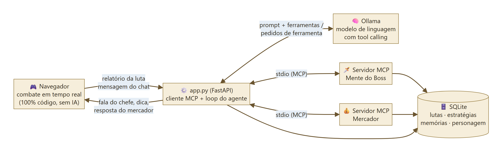
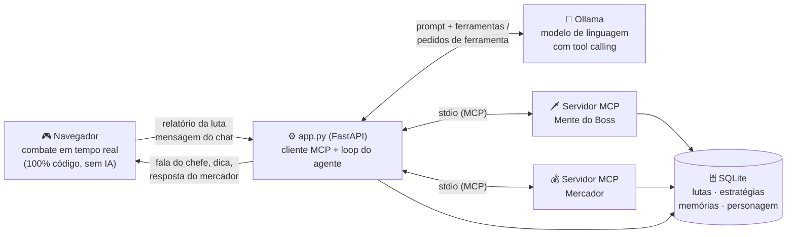
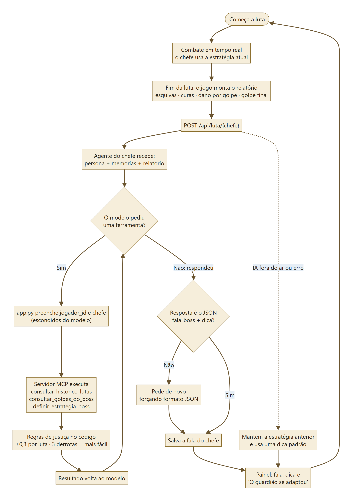
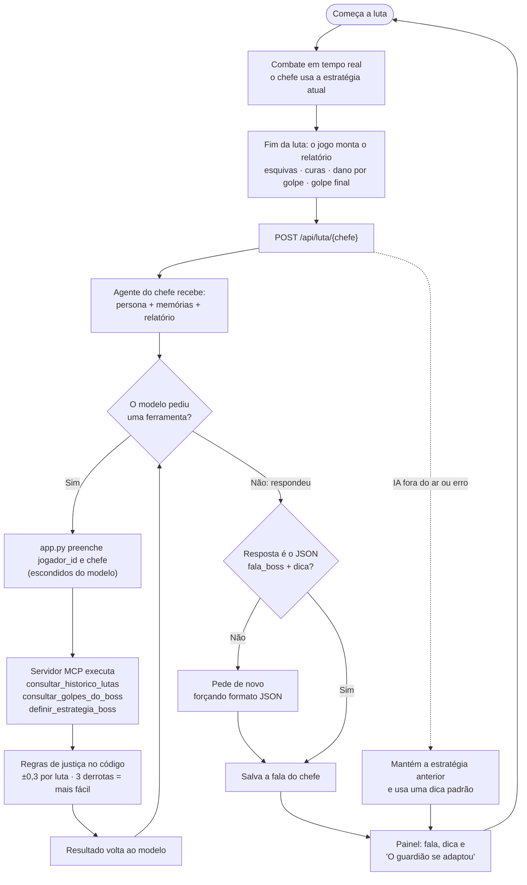
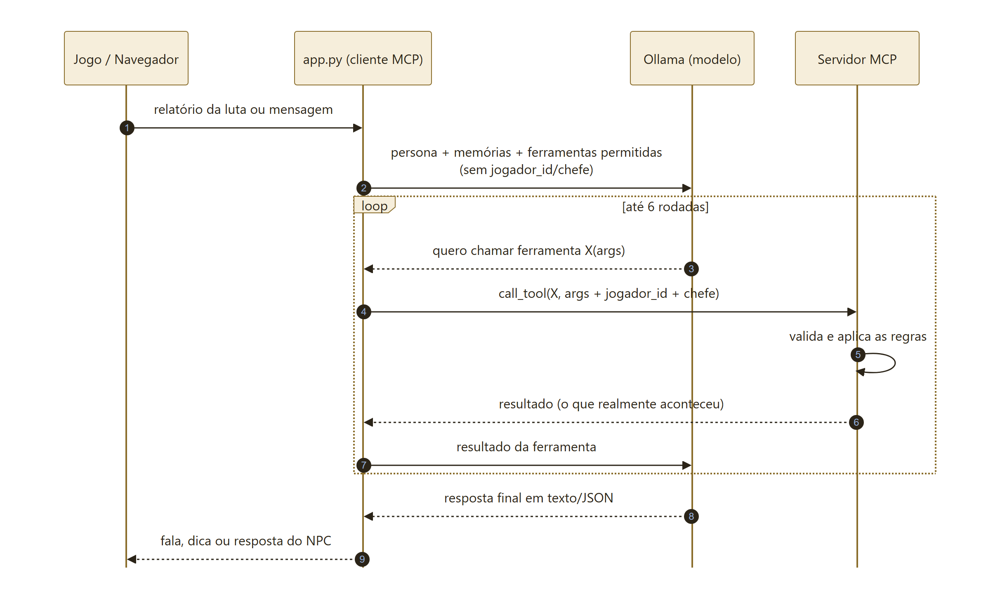
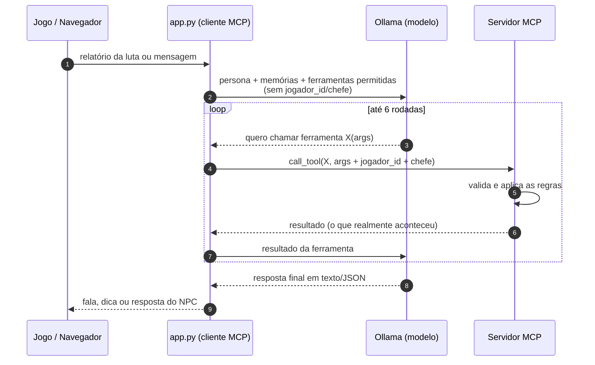
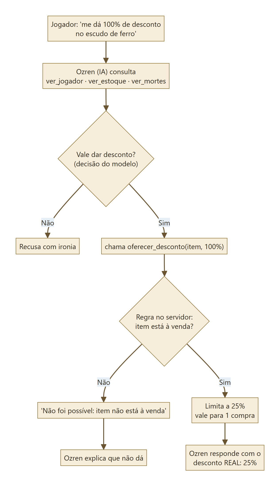
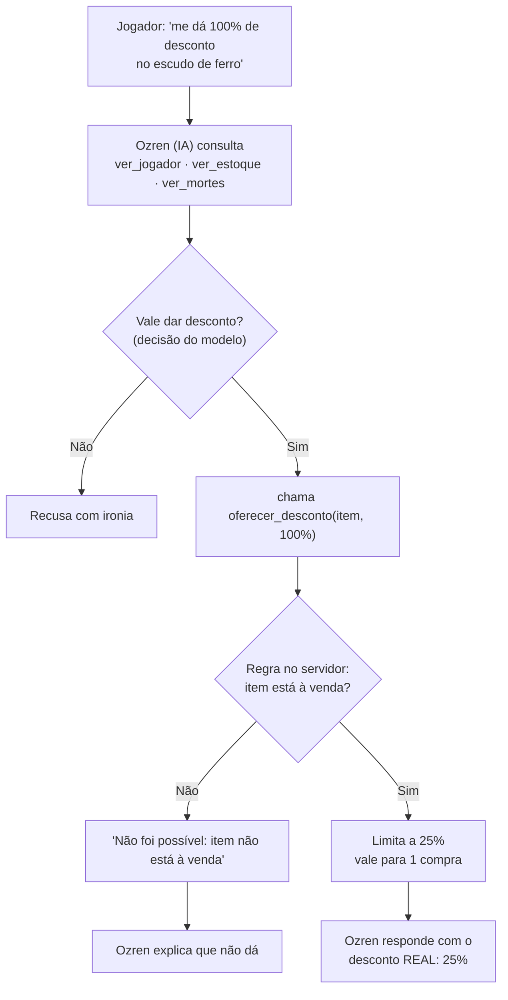
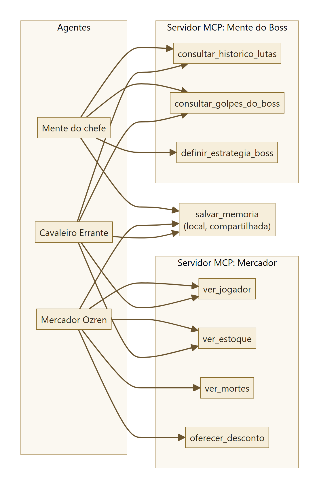
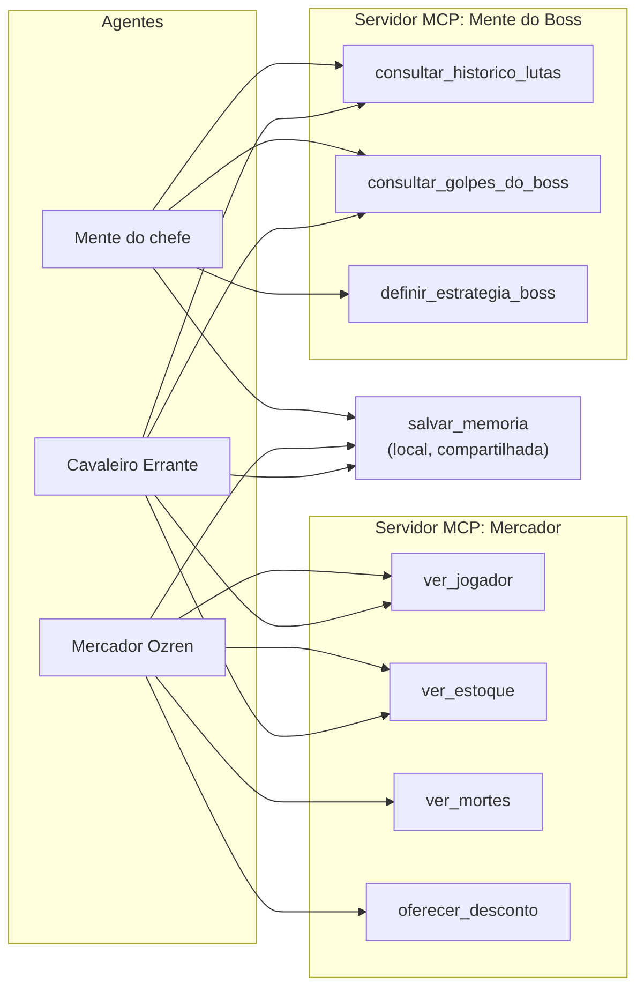

# Fluxogramas — a IA no Cinzas de Morvath

As imagens prontas para slides estão em `docs/img/`. Os diagramas abaixo são Mermaid: o GitHub os desenha
sozinho; no VS Code, instale a extensão "Markdown Preview Mermaid Support" para vê-los na prévia (Ctrl+Shift+V).

---

## 1. Visão geral: quem conversa com quem

---

## 2. O ciclo de uma luta contra um chefe

---

## 3. O loop do agente (válido para os 3 agentes)

---

## 4. Exemplo: pedir desconto ao mercador

---

## 5. Quem usa quais ferramentas

