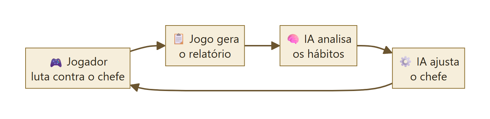
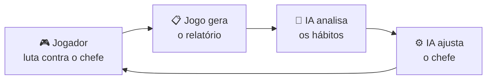
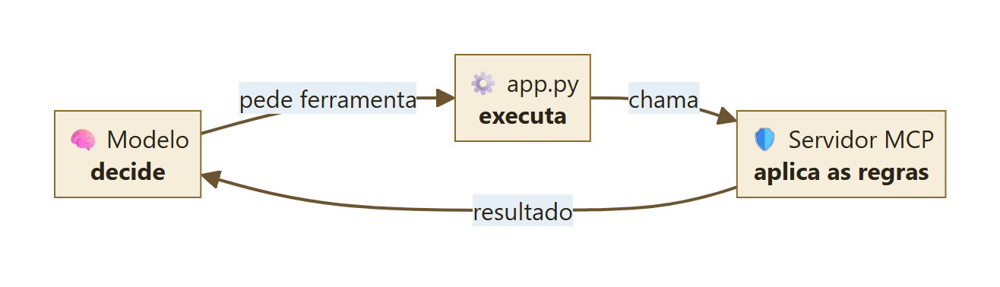
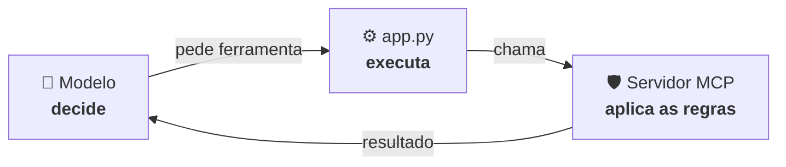
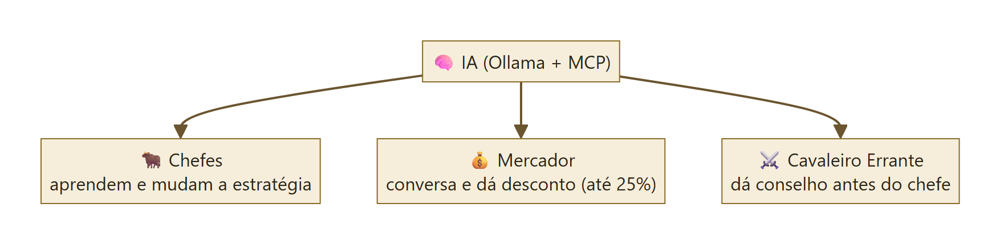
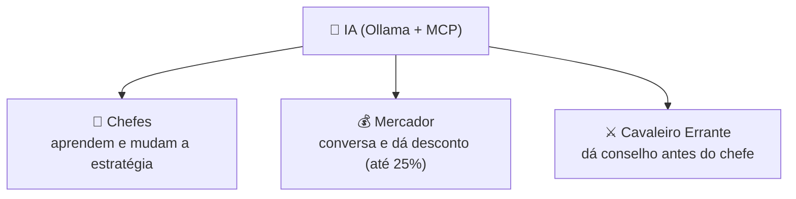

# Fluxogramas — a IA no Cinzas de Morvath

Imagens prontas para slides em `docs/img/`. (Os blocos abaixo são Mermaid: o GitHub desenha sozinho.)

---

## 1. Como a IA entra no jogo

---

## 2. Como o MCP funciona

---

## 3. Os três agentes

